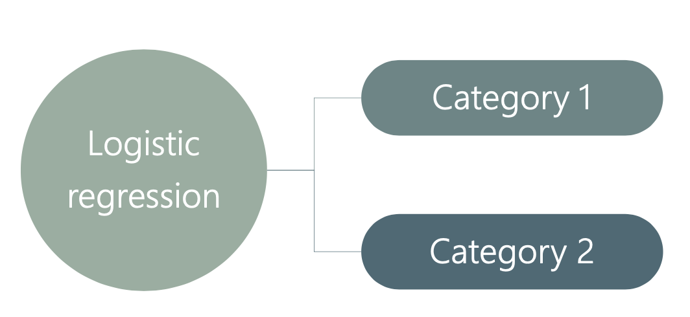
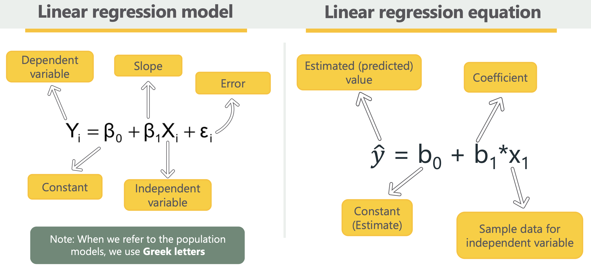
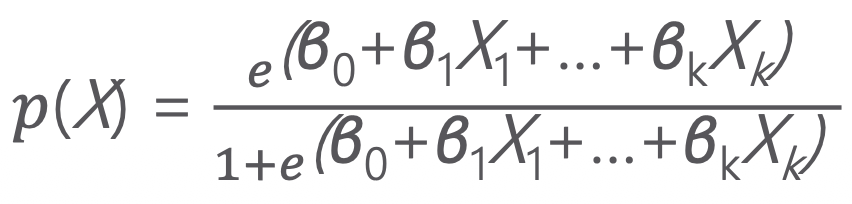
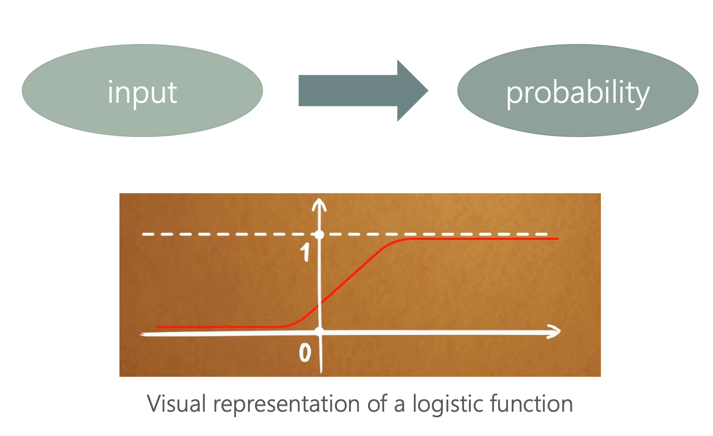
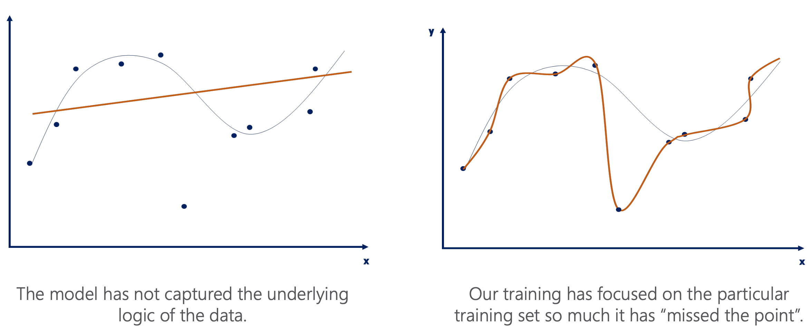

# Logistic Regression 

Logistic regression implies that the possible outcomes are not numerical but rather categorical.

Examples for categories are:
* Yes / No
* Will Buy / Won't Buy 
* 1 / 0

  

Linear Regression Model 

  

Logistic Regression Model

  

## Logistic Model 
The logistic regression predicts the probability of an event occurring.

  

**Logistic Regression Model**
The logistic regression model is not very useful in itself. The right-hand side of the model is an exponent which is very computationally inefficient and generally hard to grasp  
$$
\frac{p(X)}{1-p(X)} = e^{\left(\beta_0 + \beta_1 X_1 + \cdots + \beta_k X_k\right)}
$$

ODDS

$$
ODDS = \frac{p(X)}{1-p(X)}
$$

Coin flip odds:
- The odds of getting heads are 1:1 (or simply 1).

Fair die odds:
- The odds of getting 4 are 1:5 (1 to 5)

_Note_

Probability - Favorable outcome(s) compared to the total outcomes 
$$
Probability (P) = \frac{\text{success}}{\text{total outcomes}}
$$

Odds in Favor  - Favorable outcomes, compared to unfavorable outcomes
$$
ODDS = \text{success}:{failures}
$$

## Logit Regression Model
A logistic regression model is a _logit regression_ - a variation of the model where we have taken log of both sides
- Defining the model 
$$
\log\left(\frac{p(X)}{1-p(X)}\right)
= \log\left(e^{\beta_0 + \beta_1 x + \cdots + \beta_k x_k}\right)
$$

- Solving for log and exponent 
$$
\log\left(\frac{p(X)}{1-p(X)}\right)
= \log\left(e^{\beta_0 + \beta_1 x + \cdots + \beta_k x_k}\right)
$$

- The model equation 
$$
\log(\text{odds})
= \beta_0 + \beta_1 x + \cdots + \beta_k x_k
$$

Concrete Example

* With exponents: 2³ = 8  (2 multiplied by itself 3 times equals 8)

* With logarithms: $\log_2(8) = 3$  (What exponent do you put on 2 to get 8? The answer is 3)

## Underfitting and Overfitting  

  

A logistic regression model predicts a probability of 0.8. With a classification threshold of 0.9, the observation is classified as positive.
1 point
Yes
No
I don't know
  If the coefficient of temperature in a logistic regression is −0.3, increasing temperature by one unit multiplies the odds of the event by -0.3
1 point
Yes
No
I don't know
Lowering the classification threshold from 0.5 to 0.2 can increase the number of false positives.
1 point
Yes
No
I don't know
  A classification tree with maximum depth 1 can have at most two terminal nodes.  
1 point
Yes
No
I don't know
  A decision tree with 100% training accuracy must also have 100% test accuracy.  
1 point
Yes
No
I don't know

1. No — 0.8 is below the classification threshold of 0.9.

2. No — A coefficient of −0.3 means the odds are multiplied by 
e
−
0.3
≈
0.741
e 
−0.3
 ≈0.741, not −0.3.

3. Yes — Lowering the threshold can increase false positives because more observations are classified as positive.

4. Yes — A classification tree with maximum depth 1 can have at most two terminal nodes.

5. No — 100% training accuracy does not guarantee 100% test accuracy because the tree may overfit the training data.

