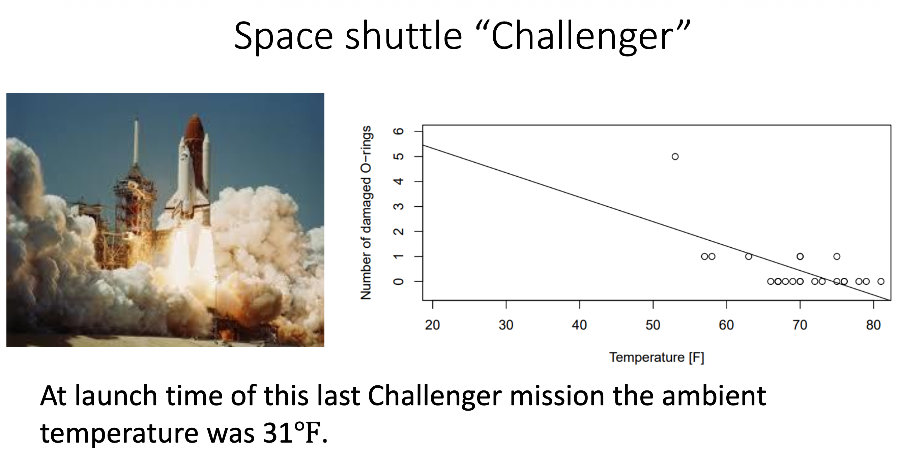
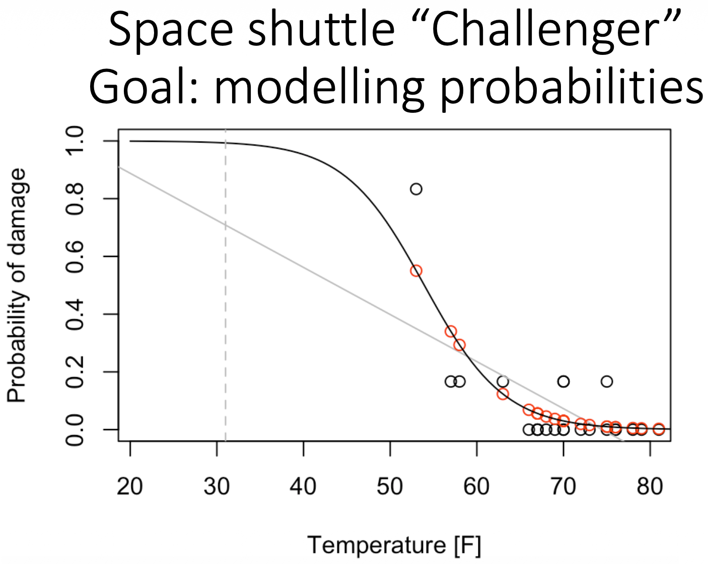

# Logistic Regression 

Logistic regression implies that the possible outcomes are not numerical but rather categorical.

Examples for categories are:
* Yes / No
* Will Buy / Won't Buy 
* 1 / 0

  

Linear Regression Model 

  

Logistic Regression Model

  

## Logistic Model 
The logistic regression predicts the probability of an event occurring.

  

**Logistic Regression Model**
Logistic regression models a probability p as the logistic function of a linear predictor, so that the log odds are linear in x.

The logistic regression model is not very useful in itself. The right-hand side of the model is an exponent which is very computationally inefficient and generally hard to grasp  
$$
\frac{p(X)}{1-p(X)} = e^{\left(\beta_0 + \beta_1 X_1 + \cdots + \beta_k X_k\right)}
$$

ODDS

$$
ODDS = \frac{p(X)}{1-p(X)}
$$

Coin flip odds:
- The odds of getting heads are 1:1 (or simply 1).

Fair die odds:
- The odds of getting 4 are 1:5 (1 to 5)

_Note_

Probability - Favorable outcome(s) compared to the total outcomes 
$$
Probability (P) = \frac{\text{success}}{\text{total outcomes}}
$$

Odds in Favor  - Favorable outcomes, compared to unfavorable outcomes
$$
ODDS = \text{success}:{failures}
$$

## Logit Regression Model
A logistic regression model is a _logit regression_ - a variation of the model where we have taken log of both sides
- Defining the model 
$$
\log\left(\frac{p(X)}{1-p(X)}\right)
= \log\left(e^{\beta_0 + \beta_1 x + \cdots + \beta_k x_k}\right)
$$

- Solving for log and exponent 
$$
\log\left(\frac{p(X)}{1-p(X)}\right)
= \log\left(e^{\beta_0 + \beta_1 x + \cdots + \beta_k x_k}\right)
$$

- The logit maps the range (0, 1) to (−∞, ∞):
$$
\operatorname{logit}(x) = \log\left(\frac{x}{1-x}\right)
$$

- The model equation 
$$
\log(\text{odds})
= \beta_0 + \beta_1 x + \cdots + \beta_k x_k
$$

- Its inverse, the logistic function, maps (−∞, ∞) to (0, 1):
$$
\operatorname{logit}^{-1}(x) = \frac{e^{x}}{1+e^{x}}
$$

**The model**
- Used to model probabilities:
$$
p = \frac{e^{\beta_0+\beta_1 x}}{1+e^{\beta_0+\beta_1 x}}
$$

$$
g(p) = \operatorname{logit}(p) = \log\left(\frac{p}{1-p}\right) = \beta_0 + \beta_1 x
$$

- We call g(·) a link function, and $\log\left(\frac{p}{1-p}\right)$ is the log odds.

Concrete Example

* With exponents: 2³ = 8  (2 multiplied by itself 3 times equals 8)

* With logarithms: $\log_2(8) = 3$ (What exponent do you put on 2 to get 8? The answer is 3)

## Underfitting and Overfitting  

  

##

Linear regression is not a good choice for the probability of failure: it can predict values below 0 or above 1, and the true relationship is S-shaped. Logistic regression fixes both problems.

###### Task
* January 1986: the launch of the space shuttle "Challenger" is under consideration.
* One concern is the O-ring seals of the solid rocket boosters: 3 primary O-rings per booster. In several earlier launches some rings showed failures (the rocket hulls were recovered and examined).
* The dataset orings records the failures observed at different temperatures.

* _Question: launch or not? The ambient temperature at launch was 31 °F._

  

- Number of damaged O-rings against temperature, with a straight regression line. The data sit between 0 and 5 damaged rings and the line runs steeply downward.

- The same data as a probability of damage. The gray straight line is the linear fit; the black S-shaped curve is the logistic fit; the dashed vertical line marks 31 °F.

  

 
 **Why Linear Regression Fails Here:**

1. **Unbounded output** - A line keeps going: on the gray line falls below 0 above roughly 75 °F, which is not a valid probability. The logistic curve stays between 0 and 1 everywhere.

2. **Wrong shape** - The observed damage fraction is near 0 for warm launches, rises quickly around 55 to 60 °F and flattens towards 1 when it is cold. A straight line cannot bend like that, so it underestimates the risk at the cold end (at 31 °F the gray line is at roughly 0.7 on the plot, the logistic curve is close to 1).

3. **Binary response** - For a 0/1 outcome the variance is p(1 − p), so it is not constant, and the errors cannot be normal. Both are assumptions of ordinary linear regression.

4. **Extrapolation caveat** - The lowest temperature in the data is about 53 °F; 31 °F is far outside the observed range. Any model, logistic included, is extrapolating there. The logistic model is the right tool for a probability, but it does not make an extrapolation safe.

***Take-away***: a response that is a probability (or a 0/1 outcome) needs a model whose output is forced into (0, 1). That is what the logit link in the next section does.

## Working Example
The student has a 37.8 % chance of an A (part a) and needs 50 hours of study for a 50 % chance (part b). The slides state the question but not the solution; the full working is below.
* Data for students in a statistics class: X1 = hours studied, X2 = undergrad GPA, Y = receive an A. A fitted logistic regression gives the estimated coefficients β̂0 = −6, β̂1 = 0.05, β̂2 = 1.

  * (a) Estimate the probability that a student who studies 40 h and has a GPA of 3.5 gets an A.
  * (b) How many hours would that student need to study for a 50 % chance of an A?

Formula:
$$
p = P(A) = \frac{\exp(\beta_0+\beta_1 x_1+\beta_2 x_2)}{1+\exp(\beta_0+\beta_1 x_1+\beta_2 x_2)}
$$

1. Compute the linear predictor (the log odds):

$ z = −6 + 0.05 · 40 + 1 · 3.5 = −6 + 2 + 3.5 = −0.5$

Then apply the logistic function:

$ p = e^(−0.5) / (1 + e^(−0.5)) = 0.6065 / 1.6065 ≈ 0.378 $

- So the estimated probability of an A is about 37.8 %. Equivalent in odds: e^(−0.5) ≈ 0.61, i.e. roughly 0.6 to 1 against.

2. Find the hours x1 that give p = 0.5 for a student with GPA 3.5. The model is linear in the log odds, not in the probability, so the target probability must first go through the link function.

- The Model on Link Scale 
$$
\operatorname{logit}(p) = \ln\frac{p}{1-p} = \beta_0 + \beta_1 x_1 + \beta_2 x_2
$$

- The target probability with the link function.
This is where the 0.5 disappears: p = 0.5 means odds of 1, and ln 1 = 0.

A logistic regression model predicts a probability of 0.8. With a classification threshold of 0.9, the observation is classified as positive.
1 point
Yes
No
I don't know
  If the coefficient of temperature in a logistic regression is −0.3, increasing temperature by one unit multiplies the odds of the event by -0.3
1 point
Yes
No
I don't know
Lowering the classification threshold from 0.5 to 0.2 can increase the number of false positives.
1 point
Yes
No
I don't know
  A classification tree with maximum depth 1 can have at most two terminal nodes.  
1 point
Yes
No
I don't know
  A decision tree with 100% training accuracy must also have 100% test accuracy.  
1 point
Yes
No
I don't know

1. No — 0.8 is below the classification threshold of 0.9.

2. No — A coefficient of −0.3 means the odds are multiplied by 
e
−
0.3
≈
0.741
e 
−0.3
 ≈0.741, not −0.3.

3. Yes — Lowering the threshold can increase false positives because more observations are classified as positive.

4. Yes — A classification tree with maximum depth 1 can have at most two terminal nodes.

5. No — 100% training accuracy does not guarantee 100% test accuracy because the tree may overfit the training data.

