# PART 1: UNDERSTANDING CLUSTERING

###### What is Clustering?
Clustering is an **unsupervised machine learning technique** that groups similar observations together based on their characteristics or features.

In simple terms, clustering allows a computer to discover natural groups in a dataset without being told beforehand which observation belongs to which group.

**Example: Student activity preferences**
Imagine collecting information from 100 students about their weekend activities:
* Hiking
* Swimming
* Going to the gym
* Watching sports
* Attending parties
* Shopping
* Going to concerts

Each student provides a rating from 1 to 10 for each activity.
You do not know which students are sporty, social, adventurous or artistic.

Using clustering, the algorithm examines their responses and identifies students with similar preferences.

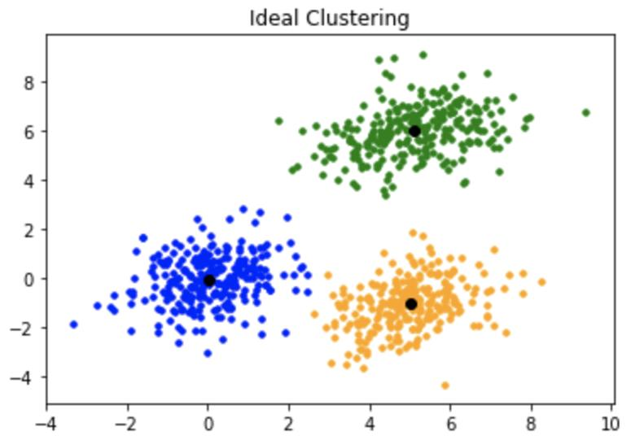

The algorithm might identify groups such as:

**Cluster**	 ---   **Possible interpretation**

Cluster 1	---    Sporty and adventurous students

Cluster 2	---    Social and outgoing students

Cluster 3	---    Relaxed and less adventurous students

These descriptions are assigned by examining the characteristics of the resulting clusters. The algorithm itself does not know what a sporty or social student is.

**Important Terminology**

- **Observation / Individual**: One record or entity in the dataset, e.g. one student.
- **Feature / Variable**: A characteristic measured about an observation.
- **Dataset**: The complete collection of observations.
- **Cluster**: A group of similar observations.
- **Similarity**: How alike two observations are.
- **Dissimilarity**: How different two observations are.
- **Centroid**: The centre or average position of a cluster.
- **Cluster label**: The number assigned to identify a cluster.

**Understanding the dataset structure**

Suppose we have the following dataset:
| Student | Hiking | Swimming | Gym |
| --- | --- | --- | --- |
| Student A | 9 | 8 | 9 |
| Student B | 8 | 9 | 8 |
| Student C | 2 | 1 | 3 |
| Student D | 3 | 2 | 2 |
| Student E | 9 | 2 | 8 |

In this example:
- Number of observations (n) = 5 students.
- Number of features (p) = 3 activities.
- Each row represents one student.
- Each column represents one feature.

The objective is to allocate the five observations into \(k\) clusters, where \(k\) represents the number of groups.

For example, if \(k=2\), the algorithm attempts to divide the students into two groups based on their activity preferences.

**Remember**: In clustering, the correct group labels are not provided during training.

## Why do we use clustering?
Its three main objectives are:
1. Discover structure and patterns in data.
2. Group observations with similar patterns together.
3. Reduce complexity and make data easier to interpret.

## Real-life Applications
| Industry | Application |
| --- | --- |
| Marketing | Grouping customers according to purchasing behaviour |
| Banking | Identifying customers with similar financial behaviour |
| Healthcare | Grouping patients according to symptoms or medical characteristics |
| Education | Identifying students with similar learning patterns |
| E-commerce | Grouping customers according to shopping preferences |
| Agriculture | Grouping farms according to production patterns |
| Human Resources | Grouping employees according to skills and performance |

**Example: Customer Segmentation**
A retail company collects information about customers' spending habits.
Clustering may identify:
- Customers who frequently purchase expensive products.
- Customers who mainly purchase discounted products.
- Customers who purchase occasionally.
- Customers who spend heavily during promotions.
The company can then develop different marketing strategies for each group.

**Key takeaway**: Clustering helps businesses understand their data and make decisions based on discovered patterns.

## Supervised vs. Unsupervised Learning
| Supervised Learning | Unsupervised Learning |
| --- | --- |
| Training data contains known labels. | Training data has no known class labels. |
| Learns from labelled examples. | Discovers patterns from the data. |
| Predicts a known target or outcome. | Identifies hidden structures or groups. |
| Examples: classification and regression. | Examples: clustering and dimensionality reduction. |
| Cross-validation can evaluate predictive performance. | Ordinary supervised cross-validation is not directly applicable. |

_Example_
**Supervised learning**:

You provide a model with student information and already-known labels:
- Student A: Sporty.
- Student B: Social.
- Student C: Academic.

The model learns to predict the category of new students.

**Unsupervised learning**:

You provide student information without labels.

The algorithm discovers groups based on similarities in the data.

- Clustering is unsupervised because the actual class labels are unknown during the clustering process.

# PART 2: TYPES OF CLUSTERING ALGORITHMS

Introducing 3 `three` main approaches
1. Hierarchical clustering.
2. K-means clustering.
3. Model-based clustering.

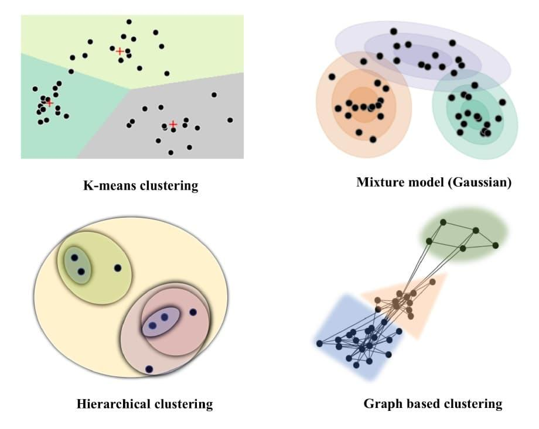

| Method | Main Idea |
| --- | --- |
| Hierarchical | Builds a hierarchy of clusters by merging or splitting groups. |
| K-means | Divides observations into a predefined number of clusters using centroids. |
| Model-based | Assumes the data comes from a mixture of probability distributions. |

# PART 3: HIERARCHICAL CLUSTERING

###### What is hierarchical clustering?
Hierarchical clustering is an unsupervised learning method that creates a hierarchy of groups by progressively merging similar observations or separating existing groups.

***Agglomerative hierarchical clustering***.

- Agglomerative means bottom-up clustering.

It starts by treating every observation as an individual cluster. It then repeatedly merges the closest clusters until all observations belong to one large cluster.

**How does it work?**
Consider six observations:
A, B, C, D, E and F.

Initially, every observation is its own cluster:

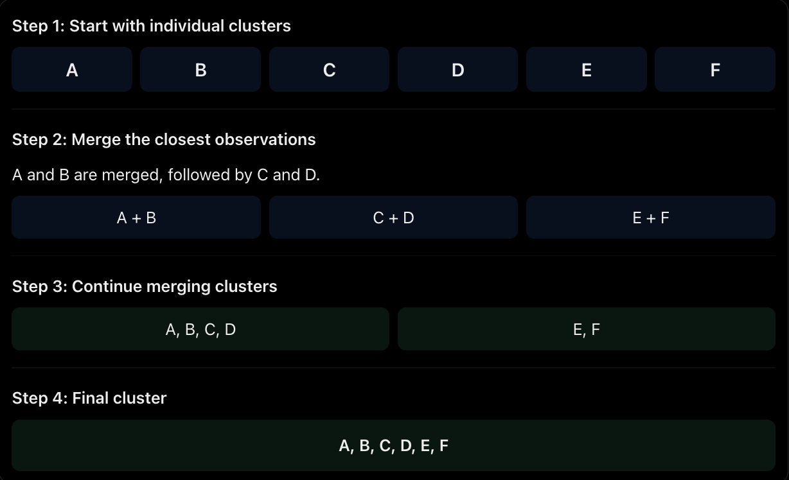

- The exact order of merging depends on the distance measure and linkage method selected.

**The Two Main Types of Hierarchical Clustering**

| Agglomerative | Divisive |
|---|---|
| Bottom-up approach. | Top-down approach. |
| Starts with individual observations. | Starts with one large cluster. |
| Repeatedly merges clusters. | Repeatedly splits clusters. |
| Commonly used in practice. | Less commonly used. |

## What is a Dendrogram?

A Dendrogram is a tree-like diagram that visually represents the sequence of merges performed during hierarchical clustering.

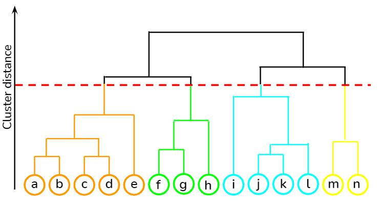

**Understanding the Dendrogram**
A dendrogram contains four important elements:
1. **Leaf nodes**: The individual observations at the bottom of the diagram. 
2. **Branches**: Connections showing how observations or groups are merged.
3. **Internal nodes**: Points where two groups are joined.
4. **Root node**: The final group containing the entire dataset. 

**How to read a Dendrogram**

The vertical axis normally represents the distance or dissimilarity at which clusters are merged.
- Merges occurring at low heights indicate that the groups are relatively similar.
- Merges occurring at high heights indicate that the groups are more dissimilar.
- Large vertical gaps between merges can suggest useful places to cut the tree.

**How do we determine the number of clusters?**
We draw a horizontal line across the dendrogram.

The number of branches that the line intersects represents the number of clusters.

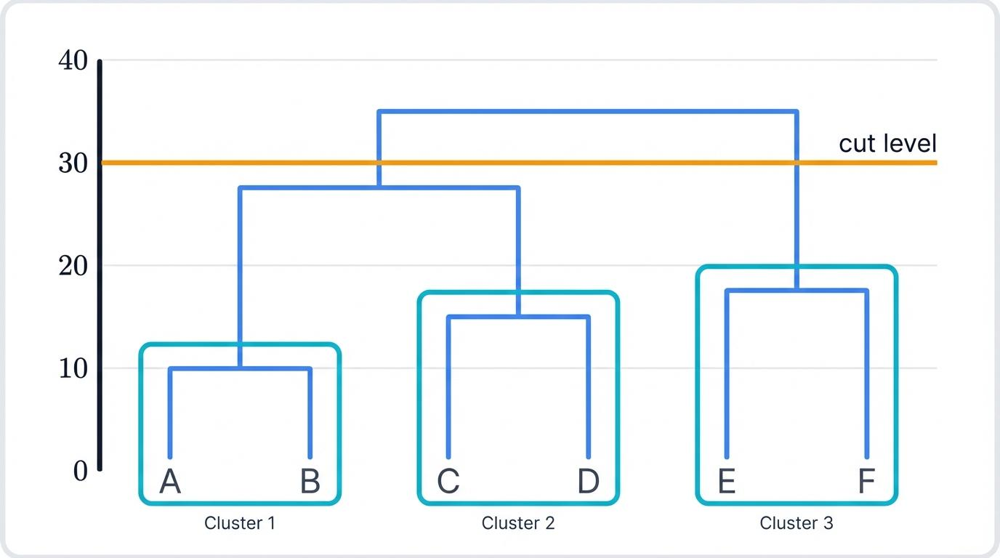

For example:
- A cut intersecting 2 branches gives 2 clusters.
- A cut intersecting 3 branches gives 3 clusters.
- A cut intersecting 4 branches gives 4 clusters.

**Important**: Hierarchical clustering allows us to inspect the data structure before deciding how many clusters to retain.

## Dissimilarity and Distance Measures
Hierarchical clustering needs a way of determining which observations or groups are closest to one another.
- This is called **dissimilarity**.

Dissimilarity should satisfy these properties:

1. **Symmetry**:
$$d(a,b) = d(b,a)$$

- The distance from A to B is the same as the distance from B to A.

2. **Positivity**:
$$
d(a,b)\geq 0
$$

- Distance cannot be negative.

3. **Increasing Dissimilarity**

The distance increases as two observations become more different.

### Euclidean distance

A measure of dissimilarity between individual observations.

- It measures the straight-line distance between two points.

For two observations with two features:
$$
A=(x_1,y_1)
$$
$$
B=(x_2,y_2)
$$

- The Euclidean distance is:

$$
d(A,B)=\sqrt{(x_2-x_1)^2+(y_2-y_1)^2}
$$

 
**Example**

Suppose: 

$$
A=(2,3), \quad B=(5,7)
$$

Then:
$$
d(A,B)=\sqrt{(5-2)^2+(7-3)^2}
$$

$$
=\sqrt{9+16}
$$

$$
=\sqrt{25}=5
$$

The distance between A and B is 5.

- For observations with more than two features, the same principle applies across all dimensions.

## Linkage Methods in Hierarchical Clustering

One of the most important concepts in hierarchical clustering is **linkage**.

- When comparing individual observations, we can calculate their Euclidean distance. However, when comparing two groups containing multiple observations, we need a rule for calculating the distance between the groups.

That rule is called a _linkage method_.

The following are linkage methods:
1. Single linkage.
2. Complete linkage.
3. Ward's method.

### Single linkage (nearest-neighbour linkage)

Single linkage defines the distance between two clusters as the smallest distance between any two observations belonging to the different clusters.

In simple terms:

- It looks for the two closest points between two groups.

$$
D(A,B)=\min_{a\in A,b\in B}d(a,b)
$$

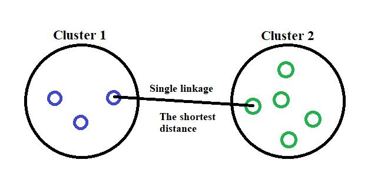

**Example**

Suppose:
- Cluster A contains observations: 1 and 3.
- Cluster B contains observations: 6 and 10.

Calculate all possible distances:
Here is your content formatted as a Markdown table:

| Comparison | Distance |
|---|---:|
| 1 and 6 | 5 |
| 1 and 10 | 9 |
| 3 and 6 | 3 |
| 3 and 10 | 7 |

Single linkage selects the smallest distance:
$$
D(A,B)=3
$$

**Advantages**
- Can identify irregularly shaped clusters.
- Can connect observations that form long, continuous structures.

**Disadvantages**
- Susceptible to the chaining effect.
- A sequence of nearby points can gradually connect two otherwise distinct groups.

### Complete linkage (furthest-neighbour linkage)
Complete linkage defines the distance between two clusters as the largest distance between any two observations belonging to the different clusters.

In simple terms:

- It looks at the two furthest points between two groups.

$$
D(A,B)=\max_{a\in A,b\in B}d(a,b)
$$

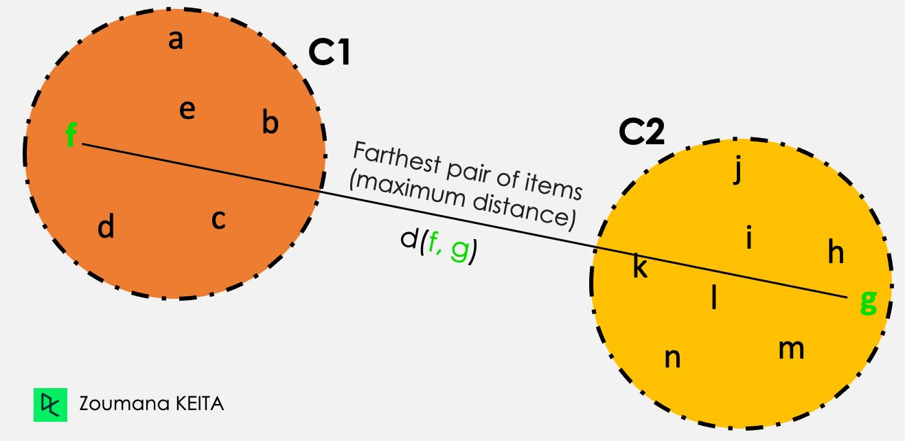

Using the previous example:

| Comparison | Distance |
|---|---:|
| 1 and 6 | 5 |
| 1 and 10 | 9 |
| 3 and 6 | 3 |
| 3 and 10 | 7 |

Single linkage selects the smallest distance:
$$
D(A,B)=9
$$

**Advantages**
- Produces relatively compact clusters.
- Helps prevent the chaining effect associated with single linkage.

**Disadvantages**
- Can be influenced by outliers.
- May separate observations that could otherwise form a meaningful irregular cluster.

### Ward's Method
Ward's method merges two clusters based on how much the total within-cluster sum of squares increases after merging.

In simple terms:

- Ward's method chooses the two clusters whose merger produces the smallest increase in within-cluster variation.

It attempts to maintain compact and relatively homogeneous clusters.

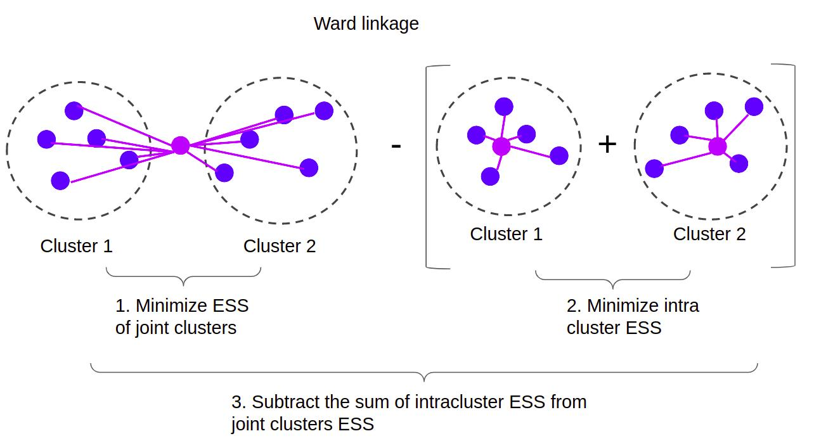

The mathematical idea is:
$$
\Delta(A,B)=WSS(A\cup B)-WSS(A)-WSS(B)
$$
Where:
- $(WSS(A))$: Within-cluster sum of squares for cluster A.
- $(WSS(B))$: Within-cluster sum of squares for cluster B.
- $(WSS(A\cup B))$: Within-cluster sum of squares after merging.
- $(\Delta(A,B))$: Increase in within-cluster variation.

Ward's method selects the merger with the smallest increase.

**Advantages**
- Usually produces compact clusters.
- Helps create relatively balanced groups.
- Useful when the aim is to minimize within-cluster variation.

**Disadvantages**
- Can be sensitive to outliers.
- Is best suited to Euclidean numerical data.
- Can struggle with irregularly shaped clusters.

| Feature | Single | Complete | Ward |
|---|---|---|---|
| Distance rule | Minimum distance | Maximum distance | Increase in WSS |
| Main focus | Closest points | Furthest points | Minimum variance increase |
| Cluster shape | Can be irregular | More compact | Compact |
| Main weakness | Chaining | Outlier sensitivity | Assumptions about cluster structure |
| Best suited for | Connected structures | Compact groups | Compact, homogeneous groups |

## Exercise 
Given:

$$
X=\{1,3,6,10\}
$$

**Step 1: Calculate pairwise distances**
| Pair | Distance |
|---|---:|
| 1 and 3 | 2 |
| 1 and 6 | 5 |
| 1 and 10 | 9 |
| 3 and 6 | 3 |
| 3 and 10 | 7 |
| 6 and 10 | 4 |

The closest observations are 1 and 3.

- Both methods initially merge these observations.

**A. Complete linkage**
1. $((1,3),6,10)$
2. $((1,3),(6,10))$
3. $((1,3,6,10))$

Explanation:
- First, 1 and 3 merge because their distance is 2.
- Next, 6 and 10 merge because their distance is 4.
- Finally, the two clusters merge.

**B. Single linkage**
1. $((1,3),6,10)$
2. $((1,3,6),10)$
3. $((1,3,6,10))$

Explanation:
- First, 1 and 3 merge.
- The distance from cluster (1,3) to 6 is the minimum of 5 and 3, which is 3.
- Therefore, 6 joins the existing cluster.
- Finally, 10 joins the cluster because its distance to 6 is 4.

**Remember**
* Single = Minimum.
* Complete = Maximum.
* Ward = Minimum increase in within-cluster variance.

# PART 4: K-MEANS CLUSTERING

###### What is K-means clustering?
K-means is an unsupervised machine learning algorithm that divides observations into a predefined number of clusters.

The main objective is to group observations so that:
* Observations withing the same cluster are as similar as possible.
* Observations in different clusters are relatively dissimilar.

Unlike hierarchical clustering, K-means requires us to specify the number of clusters, \(k\), before running the algorithm.

**Understanding centroids**

A centroid is the centre of a cluster.

It represents the mean position of all observations assigned to that cluster.

For example, imagine three groups of students:
- Cluster 1: Sporty students.
- Cluster 2: Social students.
- Cluster 3: Relaxed students.

Each cluster has a centroid representing the average activity preferences of its members.

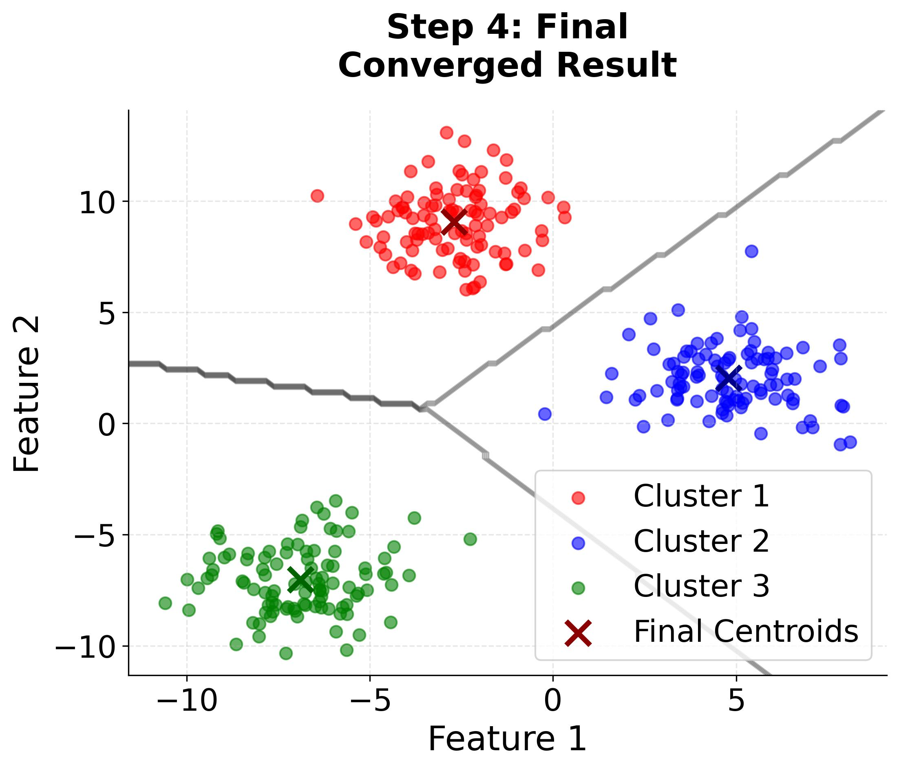

## How does the K-means algorithm work?

**Step 1: Initialize cluster centres**
- Choose \(k\) initial cluster centres (centroids).

**Step 2: Assignment step**
- Assign each observation to the nearest centroid using distance.

**Step 3: Update step**
- Recalculate each centroid by finding the mean of all observations assigned to that cluster.

**Step 4: Repeat until convergence**
- Repeat the assignment and update steps until the centroids stop changing, or another stopping condition is reached.

---
* Every observation is assigned to the nearest centroid.
* K-means uses squared Euclidean distance when determining cluster assignments.
* The observation is assigned to the cluster whose centroid produces the smallest squared distance.
* After assigning observations, the algorithm recalculates the centroid.
* For a cluster containing \(n\) observations:

$$
\mu=\frac{1}{n}\sum_{i=1}^{n}x_i
$$

Where:
- $(\mu)$ = New centroid.
- $(n)$ = Number of observations.
- $(x_i)$ = Individual observations.

The algorithm continues until the centroids no longer change significantly or the iteration limit is reached.

## What is within-cluster sum of squares?
K-means aims to minimize the total within-cluster sum of squares.

This is also called `inertia` in scikit-learn.

$$
WSS=\sum_{k=1}^{K}\sum_{x_i\in C_k}
\|x_i-\mu_k\|^2
$$

Where:
- $(K)$ = Number of clusters.
- $(C_k)$ = Cluster \(k\).
- $(x_i)$ = An observation.
- $(\mu_k)$ = Centroid of cluster \(k\).

In simple terms:

- It measures how far observations are from their assigned cluster centres.

- A smaller WSS indicates that observations are closer to their respective centroids.

- However, adding more clusters will generally reduce inertia, so we should not simply select the largest possible number of clusters.

## Choosing the optimal number of clusters
Silhouette Score to evaluate different K values.

- It is useful to understand the purpose of choosing K.

Suppose we want to segment customers.

If we choose:
- K = 2: We might group customers into two broad segments.
- K = 5: We might identify five more specific customer segments.
- K = 20: We might create too many small segments that are difficult to interpret.

The objective is to find a useful balance between separation and cohesion.

### Elbow Method
Inertia can also be examined using the Elbow Method.

The method involves:
1. Run K-means with different values of K.
2. Record the inertia for each K.
3. Plot K against inertia.
4. Identify the point where the reduction in inertia begins to slow down significantly.

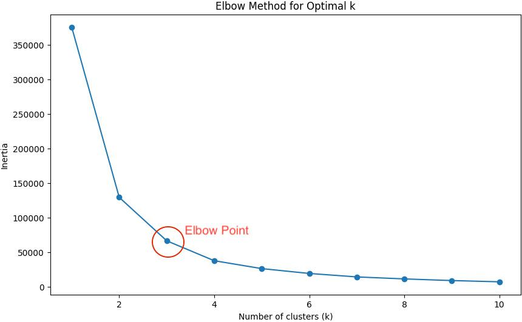

# PART 5: MODEL-BASED CLUSTERING
###### What is model-based clustering?
Model-based clustering is an unsupervised learning technique that assumes the data comes from a mixture of two or more probability distributions.

**Gaussian Mixture Models (GMM)**.

Unlike K-means, which assigns each observation to one cluster based on the nearest centroid, GMM calculates the probability that an observation belongs to each cluster.

- This is called ***soft assignment***.

## Understanding Gaussian distributions
A Gaussian distribution is also known as a **normal distribution**.

It is a probability distribution that is often represented by a bell-shaped curve.

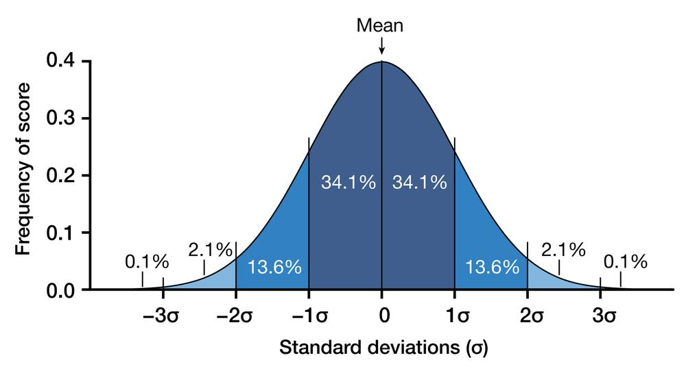

A Gaussian distribution is characterized by:
- Mean $(\mu)$: The centre of the distribution.
- Variance: How spread out the values are.
- Covariance matrix $(\Sigma)$: Describes the variances and relationships between multiple features.

In model-based clustering, each cluster is represented by a Gaussian distribution.

**Understanding Gaussian Mixture Models**
Imagine that a dataset contains three groups of customers.

Rather than assuming that each customer belongs exclusively to one group based on distance, GMM estimates the probability that each customer belongs to each of the three groups.

Example:
| Customer | Cluster 1 | Cluster 2 | Cluster 3 |
|---|---:|---:|---:|
| A | 0.85 | 0.10 | 0.05 |
| B | 0.20 | 0.70 | 0.10 |
| C | 0.15 | 0.25 | 0.60 |

For customer A:
- 85% probability of belonging to Cluster 1.
- 10% probability of belonging to Cluster 2.
- 5% probability of belonging to Cluster 3.

The highest probability indicates the most likely cluster.

**Important**: The probabilities for each observation add up to 1.

**Parameters of a Gaussian Mixture Model**

| Parameter | Meaning |
|---|---|
| $(\mu_k)$ | Mean vector of cluster k |
| $(\Sigma_k)$ | Covariance matrix of cluster k |
| Mixture probability | Probability or weight associated with the cluster |

The model uses these parameters to describe the distributions and estimate cluster membership.

## Hard Assignment vs. Soft Assignment
This is an important distinction.
| K-means (hard assignment) | GMM (soft assignment) |
|---|---|
| Each observation is assigned to one cluster. | Each observation receives probabilities for all clusters. |
| Uses nearest centroid. | Uses probability distributions. |
| Produces cluster labels directly. | Produces membership probabilities and predicted labels. |
| Does not explicitly model membership uncertainty. | Represents uncertainty in cluster membership. |

## How Gaussian Mixture Models work: EM algorithm
Through two steps:
1. Estimation Step.
2. Maximization Step.

Together, these form the Expectation-Maximization (EM) algorithm.

**E-step: Expectation**
The algorithm calculates the probability that each observation belongs to each cluster using the current model parameters.

| Observation | Cluster A | Cluster B |
|---|---:|---:|
| Student 1 | 0.80 | 0.20 |
| Student 2 | 0.40 | 0.60 |
| Student 3 | 0.90 | 0.10 |

These probabilities indicate how likely each observation is to belong to each group.

**M-step: Maximization**
The algorithm uses the probabilities calculated in the E-step to update the model parameters.

It updates:
- Cluster means.
- Covariance matrices.
- Cluster mixture weights.

Observations are weighted according to their probability of belonging to each cluster.

**Repeat until convergence**

The algorithm alternates between E-step and M-step until the model parameters stabilize or the convergence criteria are reached.

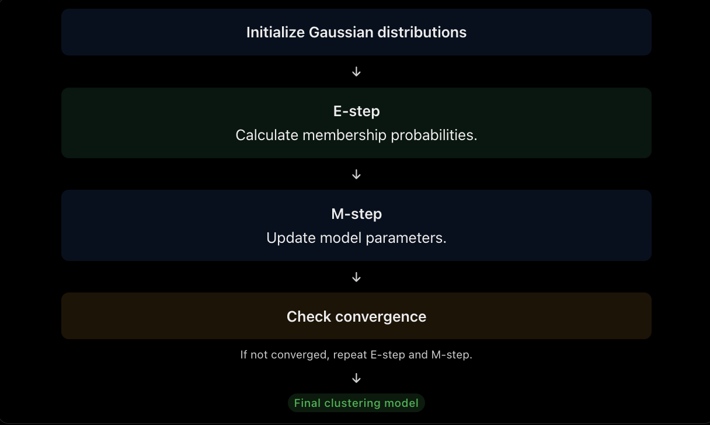

# Choosing between the three clustering methods
Now that we understand all three methods, we need to know when to use each one.
| Criteria | Hierarchical | K-means | GMM |
|---|---|---|---|
| Requires predefined K | Not strictly when building the hierarchy | Yes | Yes, number of components |
| Main technique | Repeated merging | Centroid-based assignment | Probability distributions |
| Assignment | Hard | Hard | Soft probabilities |
| Visual output | Dendrogram | Centroids and groups | Gaussian distributions |
| Cluster shape | Depends on linkage | Generally spherical/compact | More flexible |
| Best-known strength | Reveals hierarchy | Simple and efficient | Models uncertainty |
| Model selection | Cut dendrogram | Elbow/silhouette | BIC/AIC |

**Which algorithm should you choose?**

Choose hierarchical clustering when:
- You want to understand the relationships between observations.
- You do not initially know how many clusters to select.
- You want to examine the dendrogram.

Choose K-means when:
- You have a large numerical dataset.
- You want a simple and relatively fast clustering algorithm.
- You expect relatively compact clusters.

Choose GMM when:
- You want membership probabilities.
- Observations may belong partly to multiple groups.
- You want more flexible cluster shapes than standard K-means.

Note  that no clustering method is universally best. The appropriate method depends on the dataset and the objective.

