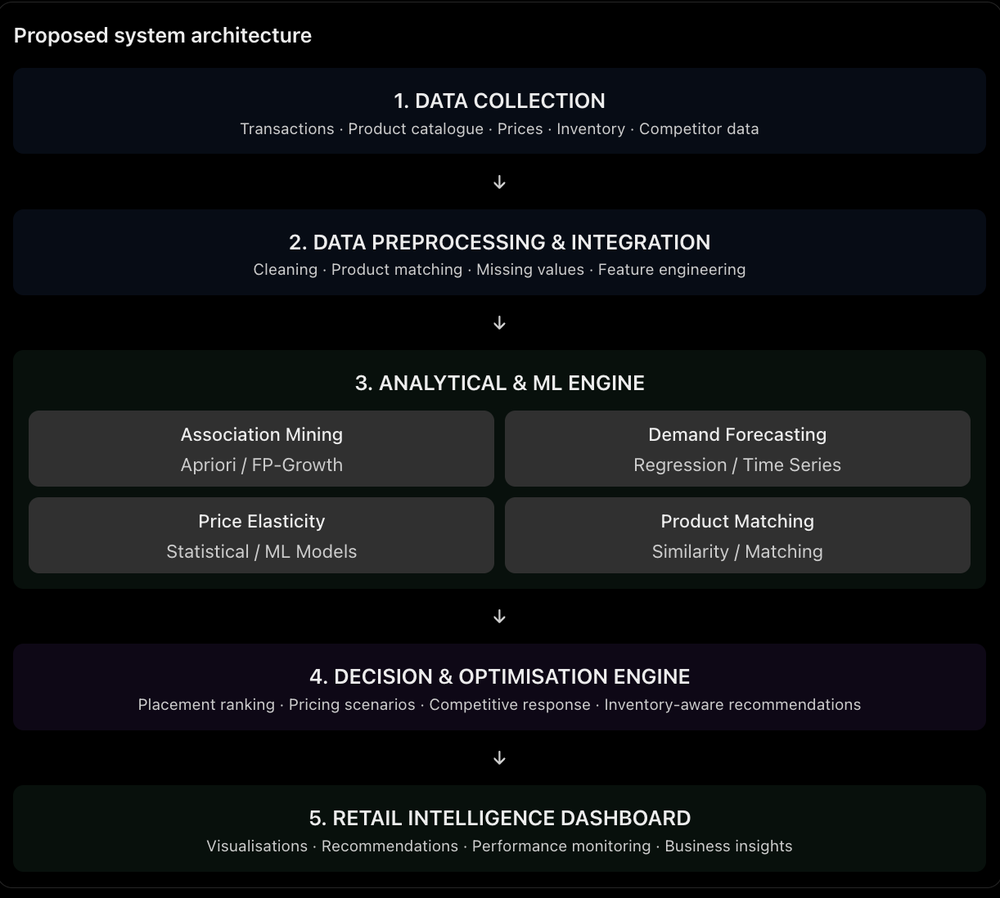

# Supermarket Product Placement and Market Basket Analysis with Retail Dynamic Pricing

## 1. Project Overview

This project develops a data-driven retail intelligence system that uses supermarket transaction data, product information, inventory records and pricing data to optimise product placement, understand customer purchasing behaviour and recommend dynamic pricing strategies.

The system aims to answer four fundamental business questions:

- `What do customers buy?` Identify purchasing patterns, popular products and customer demand.

- `What do customers buy together?` Discover product associations and complementary purchasing relationships.

- `Where should products be placed?` Translate purchasing relationships into data-driven shelf placement and cross-selling recommendations.

- `What prices should products have?` Estimate price sensitivity and recommend pricing adjustments based on demand, inventory and competitive conditions.

The project combines association rule mining, predictive analytics, demand forecasting and pricing optimisation to support supermarket decision-making.

## 2. Core System Components

### A. Market Basket Analysis

**Objective**: 

Discover relationships between products frequently purchased together.

**Data required**:

* Transaction ID

* Product ID

* Product category

* Quantity purchased

* Transaction date and time

**Algorithms**:

* Apriori

* FP-Growth

**Expected outputs**:

* Frequently purchased product combinations.

* Association rules between products.

* Support, confidence and lift scores.

* Cross-selling and product bundling opportunities.

Example:

| Product A | Product B | Business Insight |
| --- | --- | --- |
| Bread | Butter | Complementary products |
| Pasta | Pasta sauce | Bundle opportunity |
| Coffee | Biscuits | Cross-selling opportunity |

### B. Intelligent Product Placement

**Objective**: 

Convert product associations into recommendations for supermarket shelf arrangements.

Rather than relying on assumptions about which products belong together, the system uses purchasing relationships to identify complementary products.

Implementation:

1. Extract high-confidence association rules.

2. Identify products with strong purchasing relationships.

3. Rank product pairs using lift, confidence and purchase frequency.

4. Recommend proximity-based placement or promotional displays.

5. Evaluate the impact on cross-selling and basket value.

**Expected output**: 

A product placement recommendation engine that identifies products that could benefit from being displayed together.

### C. Retail Dynamic Pricing

**Objective**: 

Recommend appropriate product prices using demand patterns, price sensitivity, stock availability and competitor pricing.

The system considers:

* Historical selling prices.

* Units sold at different prices.

* Demand fluctuations.

* Inventory levels.

* Product expiration dates, where applicable.

* Competitor prices.

* Seasonal and promotional effects.

Implementation:

* Analyse historical price and sales relationships.

* Estimate product-level price elasticity.

* Forecast demand under different pricing scenarios.

* Incorporate inventory and competitor information.

* Recommend prices subject to business constraints.

**Expected output**: 

A pricing recommendation engine that estimates how price changes may affect demand, revenue and inventory movement.

## 3. Extended Analytical Modules

These five modules extend the system from basic basket analysis into a more comprehensive retail optimisation platform.

### 3.1 Long-Tail Product Module

**Focus**: 

Product matching and introductory pricing.

Identifies less frequently purchased or newly introduced products and examines their relationships with established products.

**Implementation**:

* Identify low-frequency and newly introduced products.

* Match products using category, attributes and purchasing relationships.

* Identify complementary products.

* Recommend introductory bundles or targeted discounts.

**Business value**: 

Improve product discovery and increase sales of less popular inventory.

### 3.2 Price Elasticity Module

**Focus**: Demand response to price changes.

Estimates how sensitive customers are to changes in product prices.

**Implementation**:

* Analyse historical price and sales data.

* Estimate price elasticity of demand.

* Compare elasticity across products and categories.

* Simulate different pricing scenarios.

**Business value**: 

Identify products where price adjustments are likely to increase revenue without disproportionately reducing demand.

### 3.3 Key Value Items (KVI) Module

**Focus**: Customer price perception.

Identifies products that strongly influence customers' perception of whether a supermarket offers competitive prices.

**Implementation**:

* Identify frequently purchased and highly visible products.

* Analyse customer purchasing frequency and price sensitivity.

* Compare prices against competitors.

* Rank products according to their importance to price perception.

**Business value**: Help supermarkets maintain competitive prices on strategically important products.

### 3.4 Competitive Response Module

**Focus**: Competitor price monitoring and response.

Analyses competitor pricing to identify market positioning and potential pricing opportunities.

**Implementation**:

* Collect competitor prices for matching products.

* Match equivalent products across retailers.

* Calculate price differences.

* Identify significant competitor price changes.

* Recommend appropriate responses within pricing constraints.

**Business value**: 

Support competitive pricing without automatically engaging in unnecessary price wars.

### 3.5 Omnichannel Pricing Module

**Focus**: Price coordination across physical and digital channels.

Examines pricing differences between supermarkets' physical stores, websites and mobile applications.

**Implementation**:

* Integrate product prices across sales channels.

* Identify pricing inconsistencies.

* Compare demand across channels.

* Recommend coordinated pricing strategies.

* Evaluate channel-specific promotions.

**Business value**: 

Improve pricing consistency and customer experience across retail channels.

## 4. Expected System Outputs

The final system should provide:

1. `Market Basket Dashboard`: Frequently purchased combinations, association rules and basket insights.

2. `Product Placement Recommendations`: Suggested product pairings and placement opportunities.

3. `Demand Prediction`: Forecasted product demand.

4. `Pricing Recommendations`: Suggested prices, estimated demand response and revenue implications.

5. `Competitive Intelligence`: Competitor price comparisons and market positioning.

6. `Retail Performance Dashboard`: Sales, revenue, inventory movement and pricing performance.

## 5. Overall Project Goal

To develop an integrated supermarket decision-support system that transforms transactional and market data into actionable recommendations for product placement, customer purchasing optimisation and retail pricing.

The ultimate objective is to improve basket value, increase revenue, optimise inventory movement and support evidence-based retail decisions.

## Proposed System Architecture 

<strong>Proposed System Architecture<strong>

